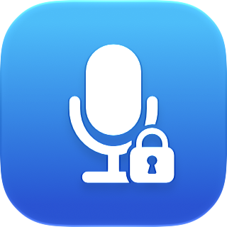
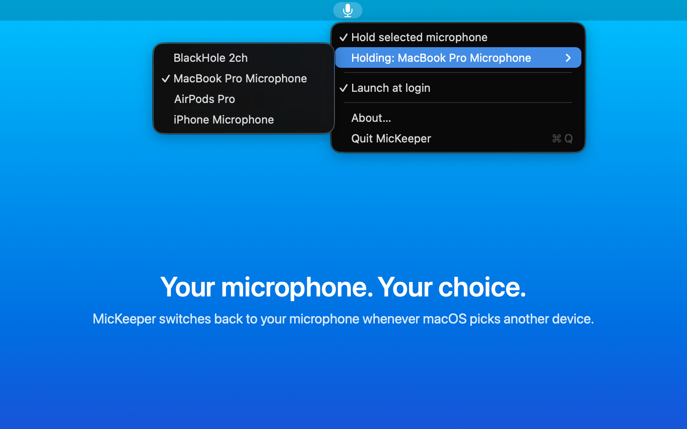

<p align="center">
  <picture>
    <source media="(prefers-color-scheme: dark)" srcset="docs/images/icon-dark.png">
    
  </picture>
</p>

<h1 align="center">MicKeeper</h1>

<p align="center">Your microphone. Your choice.<br>A native macOS menu bar utility that keeps the input device you selected.</p>

<p align="center">
  <a href="https://github.com/Roman-tex/MicKeeper/releases/latest/download/MicKeeper.dmg"></a>
</p>

<p align="center">
  
  
  
  <a href="LICENSE"></a>
  <a href="https://github.com/Roman-tex/MicKeeper/releases/latest"></a>
  <a href="https://github.com/Roman-tex/MicKeeper/actions/workflows/ci.yml"></a>
</p>

<p align="center"><a href="README.ru.md">Русский</a> · <a href="CHANGELOG.md">Changelog</a> · <a href="https://github.com/Roman-tex/MicKeeper/issues">Report an issue</a></p>

<p align="center"></p>

---

Connect AirPods, a webcam or a USB dock, and macOS often switches the system input to the new device. The next call starts on the wrong microphone.

MicKeeper sits in the menu bar and puts your microphone back as soon as something else takes its place. It does one job, uses no noticeable resources and stays out of the way.

## Principles

- **One function.** Choose a microphone, turn holding on. No windows to manage, no Dock icon, no account.
- **Native.** Swift 6, AppKit and Core Audio. No third-party dependencies, no background daemons, no helper tools.
- **Light.** About 18 MB of memory and 0% CPU at rest. MicKeeper reacts to Core Audio change notifications and never polls the hardware. The app is under 3 MB.
- **Private.** It never captures audio and does not request microphone, Accessibility or administrator access. No analytics.
- **Open.** The complete source is in this repository under the MIT license.

## Features

- Select the input device from the menu bar menu; holding is a single checkable item.
- Right-click the menu bar icon to turn holding on or off without opening the menu.
- The microphone is remembered by its Core Audio UID across launches, reconnections, sleep and audio service restarts.
- A disconnected microphone is restored automatically when it returns.
- Optional launch at login through the system Login Items service.
- Optional daily check for new stable releases on GitHub. Installation stays manual.
- Interface in English, Russian, Ukrainian, German, Spanish and Simplified Chinese. The language follows macOS and can be changed in **About MicKeeper → Language**.

## Menu bar icon

The icon is a monochrome SF Symbol, so it adapts to light, dark and tinted menu bars. Colour is deliberately avoided: in the menu bar it is reserved for the system indicator that shows an app is recording.

| Icon | Meaning |
| --- | --- |
| `microphone.fill` | Holding is on. The selected microphone is the system input. |
| `microphone` | Holding is off. macOS chooses the input as usual. |
| `microphone.badge.ellipsis.fill` | Holding is on, but the selected microphone is disconnected. It will be restored when it returns. |
| `microphone.badge.xmark.fill` | Holding is on, but the audio system reported an error. Details and **Retry** are in the menu. |

A filled microphone means "held", an outline means "not held". There is no slash, because MicKeeper never mutes anything. Turning holding on or off morphs the fill, and a short bounce means MicKeeper has just switched the input back. Animations are one-shot and are skipped when **Reduce Motion** is enabled.

## Install

1. Download [MicKeeper.dmg](https://github.com/Roman-tex/MicKeeper/releases/latest/download/MicKeeper.dmg) from the latest release.
2. Open the disk image and drag **MicKeeper** into **Applications**.
3. Open MicKeeper from Applications. The menu opens on first launch.
4. Choose your microphone and turn on **Hold selected microphone**.

### First launch

MicKeeper is signed ad hoc and is not notarized by Apple, because notarization requires a paid developer account. macOS therefore blocks the first launch with a message that it cannot verify the app. Open it in one of two ways; you do not need to disable Gatekeeper.

**System Settings (recommended).** Try to open MicKeeper once and close the warning. Open **System Settings → Privacy & Security**, scroll to **Security** and click **Open Anyway**, then confirm with your password. The button appears only after a blocked attempt and stays for about an hour ([Apple's instructions](https://support.apple.com/en-us/102445)). On macOS 15 and later, Control-clicking the app and choosing Open no longer bypasses this check.

**Terminal.** Remove the download quarantine from the installed copy only:

```sh
xattr -dr com.apple.quarantine /Applications/MicKeeper.app
```

`sudo` is not needed when you copied the app yourself. Avoid `xattr -c` or `xattr -cr`: they clear every extended attribute, not just the quarantine flag.

Run MicKeeper from Applications, not from the disk image or Downloads. macOS starts quarantined apps from a temporary read-only location, which breaks launch at login. Each update downloaded from GitHub is quarantined again and needs the same step once.

### Verify the download

Every release includes a SHA-256 checksum and, since the repository is public, a signed build provenance attestation that proves the disk image was built by this repository's GitHub Actions workflow from the tagged source:

```sh
cd ~/Downloads
shasum -a 256 -c MicKeeper.dmg.sha256
gh attestation verify MicKeeper.dmg --repo Roman-tex/MicKeeper
```

To uninstall, quit MicKeeper and move it to the Trash. If launch at login was enabled, turn it off in the menu first.

## Behavior and limits

| Situation | What MicKeeper does |
| --- | --- |
| Holding is on | Switches the system input back to the selected microphone whenever it differs. |
| Holding is off | Changes nothing and keeps the selection for later. |
| Selected microphone disconnects | Lets macOS choose temporarily and restores the microphone when it returns. |
| Sleep, wake or audio service restart | Refreshes the device list and re-subscribes to system events. |
| Temporary read or write failure | Retries with increasing delays, then shows the error in the menu. |
| Input keeps changing | Limits switching to five times per ten seconds, then resumes automatically. |
| App quits | Stops holding. The previous input is not restored. |

MicKeeper changes the **system default input**. Apps that select a microphone in their own settings may ignore it. MicKeeper reacts to a change rather than preventing it, so a brief switch is possible. It never changes the output device or the input volume.

## Privacy

MicKeeper reads audio device metadata and changes the system default input. It does not record, process or transmit audio.

Preferences are stored locally in UserDefaults. Diagnostics go to the macOS unified log under the `io.github.Roman-tex.MicKeeper` subsystem; device identifiers and names are not logged.

The only network request is the update check: an HTTPS request to GitHub's public releases API once a day, or when you click **Check for updates**. GitHub sees ordinary connection data such as your IP address. Turn the automatic check off in **About MicKeeper**.

## Build from source

Requirements: Xcode 27 or later (the app icon is an Icon Composer 27 document) and macOS 15 or later. No paid developer account is needed.

Open `MicKeeper.xcodeproj`, select the **MicKeeper** scheme and **My Mac**, then run. From the command line:

```sh
swift test                 # policy and recovery tests
./scripts/build.sh Debug   # universal debug build
./scripts/package-dmg.sh   # release build, dist/MicKeeper.dmg and checksum
```

The scripts build `arm64` and `x86_64`, verify the signature and architectures, and never install anything. The disk image window (background and icon layout) is produced by [dmgbuild](https://github.com/dmgbuild/dmgbuild), which the script installs at a pinned version into `.build/`; it is needed only for packaging, not by the app. A pushed `v*` tag builds the DMG on GitHub Actions and attaches it to a draft release.

## Architecture

```text
AppKit status item ── NSMenu / SwiftUI About window
                          │
                      AppModel
                          │
                  KeeperController
                   /      |       \
          Core Audio   Settings   Retry scheduler
               │
        AudioEventMonitor
```

- **KeeperController** holds the policy on the main actor: it reconciles device snapshots, verifies each switch and cancels delayed work when the user's intent changes.
- **CoreAudioHardware** wraps the Core Audio C API with checked calls and resolves the saved UID before every write.
- **AudioEventMonitor** owns listener lifetimes; a failing per-device listener cannot remove the system-wide ones, and stale callbacks are ignored.
- **StatusIconView** draws the SF Symbol and runs its one-shot effects; the status item button keeps click handling and accessibility.

The policy lives in the `MicKeeperCore` Swift package. Its tests replace only the external boundaries (hardware, time and listener registration), so device loss, stale callbacks and write conflicts are reproducible without touching the test machine's audio. See [docs/TESTING.md](docs/TESTING.md) for coverage and manual checks.

## Feedback

Bug reports and suggestions are welcome in [Issues](https://github.com/Roman-tex/MicKeeper/issues). Please include your macOS version, Mac model and the microphones involved.

## License

[MIT](LICENSE) © 2026 [Roman-tex](https://github.com/Roman-tex). You may use, copy, modify and distribute MicKeeper, including commercially, provided the copyright notice and license text are kept.
