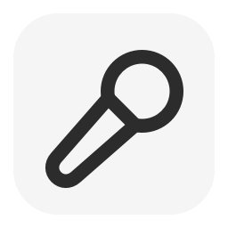

<p align="center">
  
</p>

<h1 align="center">MicKeeper</h1>
<p align="center">Your microphone. Your choice.</p>
<p align="center">A small native menu bar app that keeps your preferred macOS input device selected.</p>

MicKeeper watches the system's audio-device changes. When another device becomes the default input, it switches back to the microphone you chose. Turn it off and macOS resumes its normal selection behavior.

Built with **Swift 6**, **SwiftUI**, **AppKit** and **Core Audio**. Targets **macOS 15 or later**, with a universal Intel / Apple Silicon build. No third-party runtime dependencies.

## What it does

- Select an input device directly from the menu bar panel.
- Enable or disable holding with a switch, or **right-click the menu bar icon**.
- Keep the selection visible, grey and inactive while holding is off.
- Remember the preferred device across app launches and device reconnections.
- Optionally launch at login using the system's login-item service.
- View version, developer and licenses, and manually check GitHub for a stable release.

The panel and About window are localized in **Russian**, **English**, **Ukrainian**, **German**, **Spanish** and **Simplified Chinese**. MicKeeper follows the first supported language in macOS' preferred language list; unsupported languages fall back to English. You can override the language in **About MicKeeper → Language**; the choice is stored locally and applies immediately. Device names come from macOS and are shown as provided by the driver.

The first launch opens the panel to make the icon easy to find. Holding and launch at login are off by default. Opening the app again from Finder reopens the panel.

**The crossed-out icon means holding is off. It does not mute the microphone.**

## Install

The current `0.1.0` build is a review candidate. A published download will appear on the [Releases page](https://github.com/Roman-tex/MicKeeper/releases) after review.

1. Open `MicKeeper-0.1.0-universal.dmg`.
2. Drag **MicKeeper** into **Applications** and eject the disk image.
3. Open MicKeeper from Applications.
4. Enable holding and choose your microphone in the panel.

This build uses **ad-hoc signing**, without a Developer ID certificate or Apple notarization. A downloaded copy may be blocked on its first launch. If you trust the build, attempt to open it, then use **System Settings → Privacy & Security → Open Anyway**, following [Apple's instructions](https://support.apple.com/en-gb/102445). You do not need to disable Gatekeeper. Managed Macs may enforce stricter installation policies.

For launch at login, run the installed copy from Applications. If macOS requires approval, the panel provides a link to Login Items settings and displays the actual registration state.

## Behavior and limits

| Situation | MicKeeper's behavior |
| --- | --- |
| Holding is enabled | Applies the saved device when it differs from the system default input. |
| Holding is disabled | Cancels pending attempts, preserves the selection and makes no changes to the input. |
| Selected microphone disconnects | Lets macOS choose temporarily; restores the selected microphone when it returns. |
| App quits | Stops holding without restoring an earlier input. The enabled preference is kept for the next launch. |
| Sleep, wake or audio service reset | Refreshes devices and re-establishes event subscriptions. |
| Temporary read/write failure | Retries with bounded delays and shows an actionable error if recovery fails. |
| Another app repeatedly overrides the input | Stops automatic writes after the conflict limit; asks for a manual retry. |

MicKeeper changes the **system default input**. Apps that explicitly select their own microphone may ignore this setting. It reacts to changes rather than preventing them, so a brief transition or audio interruption is possible. The icon shows whether holding is enabled; a problem is explained in the panel and tooltip. It never changes the output device or input volume.

Devices are identified by persistent Core Audio UIDs, not names. If a driver or virtual device changes its UID, select it again. Full hardware and OS verification is tracked in [TESTING.md](docs/TESTING.md); setting a deployment target alone is not evidence of testing on that OS.

## Privacy

MicKeeper does not record, process or transmit audio. It reads audio-device metadata and changes the system default input. It does not request microphone capture, Accessibility or administrator access for this function.

Preferences stay in local UserDefaults. Diagnostics use Apple's unified logging with the `io.github.Roman-tex.MicKeeper` subsystem; device UIDs and user-assigned names are not logged. There is no analytics or background update polling.

**Check for Updates** sends a user-initiated HTTPS request to GitHub's public releases API. Normal connection metadata, including your IP address, is visible to GitHub. The app only offers the official release page; it does not download or install updates itself.

## Build and run

Requirements: Xcode with a Swift 6 toolchain and macOS 15+ SDK. The review build was developed with Xcode 26.6. No paid Apple Developer membership is required for local builds or DMG packaging.

Open `MicKeeper.xcodeproj`, select the **MicKeeper** scheme and **My Mac**, then Run. The project is configured for local ad-hoc signing.

From the repository root:

```sh
# If Xcode is installed but Command Line Tools is the active toolchain:
export DEVELOPER_DIR=/Applications/Xcode.app/Contents/Developer

swift test
./scripts/build.sh Debug
./scripts/package-dmg.sh
```

The scripts build both `arm64` and `x86_64`, verify the signature and binary architectures, and package the Release app into `dist/` with a SHA-256 checksum. They do not install the app, change login items or publish anything. The release build explicitly enables hardened runtime when applying its ad-hoc signature; this does not replace notarization.

`MicKeeperCore` is a local Swift package. Its tests can also be opened in Xcode through `Package.swift`. CI runs the tests and produces a review DMG; GitHub Releases remain a separate, manual publishing step.

## How it is built

```text
AppKit status item ── SwiftUI panel / About
                          │
                      AppModel
                          │
                  KeeperController
                   /      |       \
          Core Audio   Settings   Retry scheduler
               │
        AudioEventMonitor
```

- **KeeperController** serializes policy on the main actor, reconciles device snapshots, verifies writes and invalidates delayed work when intent changes.
- **CoreAudioHardware** contains checked C API calls and resolves a saved UID against the current device list before every write.
- **AudioEventMonitor** owns registration lifetimes. Optional per-device failures cannot dismantle system recovery listeners; obsolete callbacks are ignored.
- **SwiftUI / AppKit** provide native controls, keyboard access and a dedicated right-click action without an extra background daemon.
- **ServiceManagement / URLSession** handle login items and a manually requested release check.

Tests replace only external boundaries—hardware, time and listener registration—so device loss, stale callbacks and write conflicts are reproducible without changing the test machine's microphone. See [TESTING.md](docs/TESTING.md) for validation and outstanding hardware checks.

## License

[MIT](LICENSE) © 2026 [Roman-tex](https://github.com/Roman-tex).
The microphone artwork is covered by the [Tabler Icons MIT notice](THIRD_PARTY_NOTICES.md), included in the app's license window.
