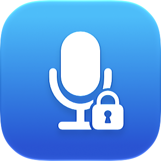
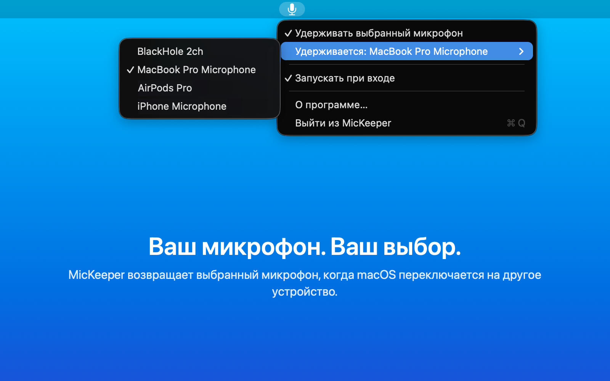

<p align="center">
  <picture>
    <source media="(prefers-color-scheme: dark)" srcset="docs/images/icon-dark.png">
    
  </picture>
</p>

<h1 align="center">MicKeeper</h1>

<p align="center">Ваш микрофон. Ваш выбор.<br>Нативная утилита для строки меню macOS, которая удерживает выбранное устройство ввода.</p>

<p align="center">
  <a href="https://github.com/Roman-tex/MicKeeper/releases/latest/download/MicKeeper.dmg"></a>
</p>

<p align="center">
  
  
  
  <a href="LICENSE"></a>
  <a href="https://github.com/Roman-tex/MicKeeper/releases/latest"></a>
  <a href="https://github.com/Roman-tex/MicKeeper/actions/workflows/ci.yml"></a>
</p>

<p align="center"><a href="README.md">English</a> · <a href="CHANGELOG.md">Список изменений</a> · <a href="https://github.com/Roman-tex/MicKeeper/issues">Сообщить об ошибке</a></p>

<p align="center"></p>

---

Стоит подключить AirPods, веб-камеру или USB-хаб, и macOS нередко переключает системный вход на новое устройство. Следующий созвон начинается с чужого микрофона.

MicKeeper живёт в строке меню и возвращает ваш микрофон, как только его место занимает другое устройство. Программа выполняет одну задачу, не расходует заметных ресурсов и не мешает работе.

## Принципы

- **Одна функция.** Выберите микрофон и включите удержание. Никаких окон, значка в Dock и учётных записей.
- **Нативность.** Swift 6, AppKit и Core Audio. Без сторонних зависимостей, фоновых демонов и вспомогательных утилит.
- **Лёгкость.** Около 18 МБ памяти и 0% CPU в покое. MicKeeper реагирует на уведомления Core Audio и не опрашивает оборудование. Размер приложения — меньше 3 МБ.
- **Приватность.** Звук не записывается; доступ к микрофону, универсальному доступу и правам администратора не запрашивается. Аналитики нет.
- **Открытость.** Полный исходный код — в этом репозитории, лицензия MIT.

## Возможности

- Выбор устройства ввода прямо в меню; удержание включается одним пунктом с галочкой.
- Правый клик по значку в строке меню включает или выключает удержание без открытия меню.
- Микрофон запоминается по Core Audio UID и переживает перезапуск, переподключение, сон и перезапуск аудиослужбы.
- Отключённый микрофон автоматически возвращается, когда снова появляется.
- Запуск при входе через системную службу объектов входа (по желанию).
- Ежедневная проверка новых стабильных версий на GitHub (по желанию). Обновление устанавливается вручную.
- Интерфейс на русском, английском, украинском, немецком, испанском и упрощённом китайском. Язык следует настройкам macOS и меняется в **О программе MicKeeper → Язык**.

## Значок в строке меню

Значок — монохромный SF Symbol, поэтому он подстраивается под светлую, тёмную и тонированную строку меню. Цвет не используется намеренно: в строке меню он зарезервирован за системным индикатором записи с микрофона.

| Значок | Значение |
| --- | --- |
| `microphone.fill` | Удержание включено, выбранный микрофон — системный вход. |
| `microphone` | Удержание выключено, macOS выбирает вход как обычно. |
| `microphone.badge.ellipsis.fill` | Удержание включено, но выбранный микрофон отключён. Он вернётся, когда появится снова. |
| `microphone.badge.xmark.fill` | Удержание включено, но аудиосистема сообщила об ошибке. Подробности и **Повторить** — в меню. |

Залитый микрофон означает «удерживается», контурный — «не удерживается». Перечёркивания нет, потому что MicKeeper ничего не выключает. При включении и выключении удержания заливка плавно перетекает, а короткий отскок означает, что MicKeeper только что вернул микрофон. Анимации однократные и отключаются при включённой настройке **Уменьшить движение**.

## Установка

1. Скачайте [MicKeeper.dmg](https://github.com/Roman-tex/MicKeeper/releases/latest/download/MicKeeper.dmg) из последнего релиза.
2. Откройте образ и перетащите **MicKeeper** в **Программы**.
3. Запустите MicKeeper из папки «Программы». При первом запуске меню откроется само.
4. Выберите микрофон и включите **Удерживать выбранный микрофон**.

### Первый запуск

MicKeeper подписан ad hoc и не заверен Apple: нотаризация требует платного аккаунта разработчика. Поэтому при первом запуске macOS сообщает, что не может проверить приложение, и блокирует его. Открыть его можно одним из двух способов; отключать Gatekeeper не нужно.

**Системные настройки (рекомендуется).** Попробуйте открыть MicKeeper и закройте предупреждение. Откройте **Системные настройки → Конфиденциальность и безопасность**, прокрутите до раздела **Безопасность** и нажмите **Всё равно открыть** (Open Anyway), затем подтвердите паролем. Кнопка появляется только после заблокированной попытки и держится около часа ([инструкция Apple](https://support.apple.com/ru-ru/102445)). В macOS 15 и новее открытие через Control-клик → «Открыть» эту проверку больше не обходит.

**Терминал.** Снимите карантин загрузки только с установленной копии:

```sh
xattr -dr com.apple.quarantine /Applications/MicKeeper.app
```

`sudo` не нужен, если приложение скопировали вы сами. Не используйте `xattr -c` или `xattr -cr`: они стирают все расширенные атрибуты, а не только флаг карантина.

Запускайте MicKeeper из «Программ», а не из образа или «Загрузок»: приложения на карантине macOS запускает из временной папки только для чтения, и запуск при входе перестаёт работать. Каждое обновление, скачанное с GitHub, снова попадает на карантин и требует того же шага один раз.

### Проверка загрузки

К каждому релизу приложены контрольная сумма SHA-256 и подписанная аттестация происхождения: она подтверждает, что образ собран сценарием GitHub Actions этого репозитория из исходников релизного тега.

```sh
cd ~/Downloads
shasum -a 256 -c MicKeeper.dmg.sha256
gh attestation verify MicKeeper.dmg --repo Roman-tex/MicKeeper
```

Удаление: выключите запуск при входе в меню, закройте MicKeeper и переместите его в Корзину.

## Поведение и ограничения

| Ситуация | Что делает MicKeeper |
| --- | --- |
| Удержание включено | Возвращает выбранный микрофон, как только системный вход отличается от него. |
| Удержание выключено | Ничего не меняет и сохраняет выбор. |
| Выбранный микрофон отключён | Временно доверяет выбор macOS и возвращает микрофон, когда тот появится. |
| Сон, пробуждение, перезапуск аудиослужбы | Обновляет список устройств и заново подписывается на системные события. |
| Временный сбой чтения или записи | Повторяет попытки с растущей задержкой, затем показывает ошибку в меню. |
| Вход постоянно меняется | Ограничивает переключения пятью за десять секунд и продолжает автоматически. |
| Выход из программы | Удержание прекращается, прежний вход не восстанавливается. |

MicKeeper меняет **системный вход по умолчанию**. Программы, где микрофон выбран в собственных настройках, могут его игнорировать. MicKeeper реагирует на смену входа, а не предотвращает её, поэтому кратковременное переключение возможно. Устройство вывода и громкость входа не меняются.

## Конфиденциальность

MicKeeper читает метаданные аудиоустройств и меняет системный вход по умолчанию. Звук не записывается, не обрабатывается и не передаётся.

Настройки хранятся локально в UserDefaults. Диагностика пишется в системный журнал macOS (подсистема `io.github.Roman-tex.MicKeeper`); идентификаторы и названия устройств не записываются.

Единственный сетевой запрос — проверка обновлений: HTTPS-запрос к публичному API релизов GitHub раз в сутки или по кнопке **Проверить обновления**. GitHub видит обычные данные соединения, например IP-адрес. Автоматическую проверку можно выключить в окне **О программе MicKeeper**.

## Сборка из исходников

Нужны Xcode 27 или новее (иконка сделана в Icon Composer 27) и macOS 15 или новее. Платный аккаунт разработчика не нужен.

Откройте `MicKeeper.xcodeproj`, выберите схему **MicKeeper** и **My Mac**, нажмите Run. Из терминала:

```sh
swift test                 # тесты логики и восстановления
./scripts/build.sh Debug   # универсальная отладочная сборка
./scripts/package-dmg.sh   # релизная сборка, dist/MicKeeper.dmg и контрольная сумма
```

Скрипты собирают `arm64` и `x86_64`, проверяют подпись и архитектуры и ничего не устанавливают в систему. Окно образа (фон и расположение значков) создаёт [dmgbuild](https://github.com/dmgbuild/dmgbuild): скрипт ставит его фиксированной версии в `.build/`, он нужен только для упаковки, а не приложению. Тег `v*` запускает сборку DMG в GitHub Actions и прикладывает его к черновику релиза.

Устройство кода описано в [английском README](README.md#architecture), проверки — в [docs/TESTING.md](docs/TESTING.md).

## Обратная связь

Ошибки и предложения — в [Issues](https://github.com/Roman-tex/MicKeeper/issues). Укажите версию macOS, модель Mac и используемые микрофоны.

## Лицензия

[MIT](LICENSE) © 2026 [Roman-tex](https://github.com/Roman-tex). MicKeeper можно использовать, копировать, изменять и распространять, в том числе в коммерческих целях, при условии сохранения уведомления об авторских правах и текста лицензии.
